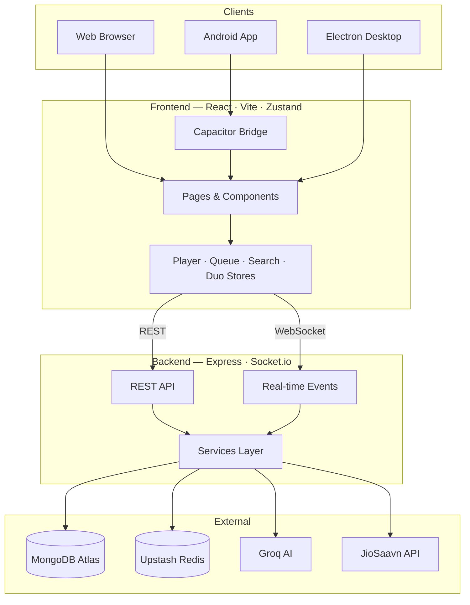

<div align="center">

# SoulSync

**Open-source music streaming with AI playlists, real-time listening sessions, and cross-platform clients.**

[Live Demo](https://soul-sync-beta.vercel.app) · [Releases](https://github.com/itslokeshx/SoulSync/releases) · [Report Issue](https://github.com/itslokeshx/SoulSync/issues)

<br>

[](https://github.com/itslokeshx/SoulSync/releases)
[](LICENSE)
[](https://nodejs.org)
[](https://react.dev)
[](https://www.typescriptlang.org)

<br>

*Listen together. Feel together.*

</div>

---

## Overview

SoulSync is a full-stack music streaming platform built for ad-free listening, intelligent discovery, and shared playback. It combines a React web client, native Android app, and optional Electron desktop builds with a Node.js backend that powers search, personalization, AI-generated playlists, and real-time **SoulLink** sessions.

The project is production-oriented: deployed on Vercel and Render, backed by MongoDB Atlas and optional Upstash Redis, and used by a growing community of active listeners.

### Highlights

| Capability | Description |
|------------|-------------|
| **Intelligent search** | Seven-signal ranking engine prioritizing originals over covers, with Redis-backed caching |
| **AI playlists** | Mood-based generation and song-list matching via Groq (LLaMA 3.3 70B) |
| **SoulLink** | Synchronized listening rooms with chat, host controls, and six-character join codes |
| **Universal import** | Import playlists from Spotify, YouTube Music, Apple Music, Gaana, or plain text |
| **Offline playback** | Downloaded tracks with IndexedDB (web) and Capacitor filesystem (Android) |
| **SoulSync Wrapped** | Personal listening stats, top tracks, and shareable summary visuals |
| **Cross-platform** | Web, Android (Capacitor), and desktop (Electron) |

---

## Table of Contents

- [Downloads](#downloads)
- [Architecture](#architecture)
- [Tech Stack](#tech-stack)
- [Project Structure](#project-structure)
- [Getting Started](#getting-started)
- [Environment Variables](#environment-variables)
- [Deployment](#deployment)
- [API Reference](#api-reference)
- [Security](#security)
- [Contributing](#contributing)
- [Acknowledgments](#acknowledgments)
- [License](#license)

---

## Downloads

| Platform | Link | Requirements |
|----------|------|--------------|
| **Web** | [soul-sync-beta.vercel.app](https://soul-sync-beta.vercel.app) | Modern browser |
| **Android** | [SoulSync 4.0 APK](https://github.com/itslokeshx/SoulSync/releases/download/v4.0/SoulSync_4.0.apk) | Android 7.0+ (API 24+) |
| **Windows** | [SoulSync 3.0.0](https://github.com/itslokeshx/SoulSync/releases/download/v3.0.0/SoulSync_3.0.0.exe) | Windows 10+ |
| **Linux** | [soulsync 3.0.0 deb](https://github.com/itslokeshx/SoulSync/releases/download/v3.0.0/soulsync_3.0.0.deb) | Debian / Ubuntu |

Additional builds and release notes are available on the [GitHub Releases](https://github.com/itslokeshx/SoulSync/releases) page.

---

## Architecture



### Request flow

1. User actions update Zustand stores on the client.
2. REST calls hit Express route handlers; real-time duo events use Socket.io.
3. Services layer handles business logic, caching, and external API integration.
4. MongoDB persists users, playlists, listening history, and sessions.
5. Redis caches search, dashboard, and AI responses where configured.

### SoulLink (real-time sync)

| Event | Purpose |
|-------|---------|
| `duo:join` | Join a room by code |
| `duo:sync-song-change` | Sync current track and queue |
| `duo:sync-play` | Sync play/pause state and timestamp |
| `duo:sync-seek` | Sync playback position |
| `duo:message` | In-session chat |
| `duo:end-session` | End the session |
| Heartbeat (5s) | Connection monitoring and cleanup |

---

## Tech Stack

| Layer | Technologies |
|-------|-------------|
| **Frontend** | React 18 · TypeScript 5.7 · Vite 6 · Tailwind CSS 3.4 · Zustand 5 · TanStack Query 5 · Framer Motion |
| **Mobile** | Capacitor 8 · Android API 24+ |
| **Desktop** | Electron 35 · electron-builder |
| **Backend** | Node.js 18+ · Express 4.21 · Socket.io 4.8 · TypeScript 5.7 |
| **Data** | MongoDB 8.9 · Upstash Redis (optional) |
| **AI** | Groq SDK · LLaMA 3.3 70B |
| **Auth** | Google OAuth 2.0 · JWT · httpOnly cookies |
| **Infrastructure** | Vercel (frontend) · Render (backend) · MongoDB Atlas |

---

## Project Structure

```
SoulSync/
├── package.json              # Root workspace scripts
├── render.yaml               # Render deployment config
├── frontend/
│   ├── src/
│   │   ├── pages/            # Route-level views
│   │   ├── components/       # UI, player, layout, cards
│   │   ├── store/            # Zustand state
│   │   ├── duo/              # SoulLink session module
│   │   ├── capacitor/        # Native Android bridge
│   │   └── hooks/            # Shared React hooks
│   ├── android/              # Capacitor Android project
│   └── electron/             # Desktop app shell
└── backend/
    └── src/
        ├── routes/           # REST endpoints
        ├── services/         # Business logic & integrations
        ├── models/           # MongoDB schemas
        ├── middleware/       # Auth, rate limiting
        └── socket/           # Socket.io handlers
```

---

## Getting Started

### Prerequisites

| Requirement | Version | Required for |
|-------------|---------|--------------|
| Node.js | ≥ 18 | All development |
| npm | ≥ 9 | Package management |
| MongoDB Atlas | Free M0 tier | User data & playlists |
| Google Cloud OAuth | Client ID (+ secret for APK) | Authentication |
| Groq API key | Free tier | AI playlist features |
| Android Studio | Latest | APK builds only |

### Installation

```bash
# Clone the repository
git clone https://github.com/itslokeshx/SoulSync.git
cd SoulSync

# Install dependencies for frontend and backend
npm run install:all

# Copy environment templates
cp frontend/.env.example frontend/.env
cp backend/.env.example backend/.env
```

Edit both `.env` files with your credentials (see [Environment Variables](#environment-variables)).

### Development

Run the backend and frontend in separate terminals:

```bash
# Terminal 1 — API server (default: http://localhost:4000)
npm run dev:backend

# Terminal 2 — Vite dev server (default: http://localhost:5173)
npm run dev:frontend
```

Open [http://localhost:5173](http://localhost:5173) in your browser.

### Build & verify

```bash
npm run build:backend
npm run build:frontend
npm run typecheck
```

### Android APK

```bash
cd frontend
npm run build
npx cap sync android
cd android && ./gradlew assembleRelease
# Output: android/app/build/outputs/apk/release/app-release.apk
```

### Desktop (Electron)

```bash
cd frontend
npm run electron:dev      # Development
npm run electron:build    # Build .deb (Linux) and .exe (Windows)
```

---

## Environment Variables

### Frontend (`frontend/.env`)

All client-side variables must use the `VITE_` prefix.

```env
VITE_BACKEND_URL=http://localhost:4000
VITE_GOOGLE_CLIENT_ID=your-client-id.apps.googleusercontent.com
VITE_JIOSAAVN_API=https://saavn.sumit.co/api
VITE_DUO_BACKEND=http://localhost:4000
VITE_GITHUB_REPO=itslokeshx/SoulSync
```

### Backend (`backend/.env`)

```env
PORT=4000
NODE_ENV=development
FRONTEND_URL=http://localhost:5173
BACKEND_URL=http://localhost:4000

MONGODB_URI=mongodb+srv://<user>:<password>@<cluster>.mongodb.net/soulsync
JWT_SECRET=your-64-char-hex-secret
GOOGLE_CLIENT_ID=your-client-id.apps.googleusercontent.com
GOOGLE_CLIENT_SECRET=your-client-secret
GOOGLE_REDIRECT_URI=http://localhost:4000/api/auth/google/callback

GROQ_KEY_1=gsk_xxxxx
JIOSAAVN_API=https://saavn.sumit.co/api

UPSTASH_REDIS_REST_URL=https://your-db.upstash.io
UPSTASH_REDIS_REST_TOKEN=AXxxxxxxxxxx
```

> **Important:** Backend variables must **not** use the `VITE_` prefix. Restart both dev servers after changing environment files.

See `frontend/.env.example` and `backend/.env.example` for the full list, including optional Groq key rotation and admin configuration.

---

## Deployment

### Frontend → Vercel

1. Import the repository on [vercel.com](https://vercel.com).
2. Set the root directory to `frontend` (or configure build settings accordingly).
3. Add all `VITE_*` environment variables.
4. Add your deployed URL to Google OAuth **Authorized JavaScript origins**.

The included `vercel.json` handles SPA routing.

### Backend → Render

1. Create a Web Service connected to this repository.
2. Set root directory to `backend`.
3. Build command: `npm install --include=dev && npm run build`
4. Start command: `npm start`
5. Configure all backend environment variables.

`render.yaml` provides a reference configuration. The server includes a keep-alive self-ping to mitigate Render free-tier cold starts.

### Google OAuth setup

Add the following to your Google Cloud OAuth credentials:

| Setting | Value |
|---------|-------|
| Authorized JavaScript origins | Your Vercel URL, `http://localhost:5173` |
| Authorized redirect URIs | `https://your-backend.onrender.com/api/auth/google/callback` |

---

## API Reference

Base URL: `https://your-backend-domain.com`

| Method | Endpoint | Description |
|--------|----------|-------------|
| `GET` | `/health` | Health check |
| `POST` | `/api/auth/google` | Authenticate with Google ID token |
| `GET` | `/api/search?q=...` | Ranked search |
| `GET` | `/api/search/artist/:id` | Artist top songs |
| `GET` | `/api/search/album/:id` | Album tracklist |
| `GET` | `/api/dashboard` | Personalized home sections (auth) |
| `GET` | `/api/dashboard/guest` | Guest dashboard |
| `GET/POST/PATCH/DELETE` | `/api/playlists/*` | Playlist CRUD |
| `POST` | `/api/ai/generate` | Generate playlist from mood |
| `POST` | `/api/ai/match` | Match songs from a text list |
| `POST` | `/api/import/detect` | Detect platform from import URL |
| `POST` | `/api/session/create` | Create SoulLink room |
| `POST` | `/api/session/join` | Join SoulLink room |
| `GET` | `/api/user/*` | Profile, preferences, and stats |
| `GET` | `/api/recommendations/*` | Personalized recommendations |
| `GET` | `/api/mixes/*` | Curated mixes |
| `GET` | `/api/radio/*` | Radio stations |
| `POST` | `/api/feedback` | Submit user feedback |

Real-time duo session events are handled over Socket.io on the same backend host.

---

## Security

| Concern | Implementation |
|---------|----------------|
| Authentication | Google OAuth 2.0 — no passwords stored |
| Sessions | httpOnly, Secure, SameSite cookies |
| HTTP headers | Helmet (CSP, CORP, COOP) |
| CORS | Strict origin validation |
| Rate limiting | Configurable per-route limits; tighter on AI endpoints |
| Input validation | Zod schemas on REST endpoints |
| JWT | Verified on all protected routes |

---

## Contributing

Contributions are welcome. To get started:

1. Fork the repository and create a feature branch (`feat/your-feature`).
2. Install dependencies and configure environment files.
3. Run `npm run typecheck` and verify your changes locally.
4. Open a pull request with a clear description of the change.

### Commit convention

This project follows [Conventional Commits](https://www.conventionalcommits.org/):

- `feat:` — New feature
- `fix:` — Bug fix
- `docs:` — Documentation
- `refactor:` — Code restructuring
- `perf:` — Performance improvement
- `chore:` — Tooling or build changes

### PR checklist

- [ ] `npm run typecheck` passes
- [ ] `npm run build:frontend` and `npm run build:backend` succeed
- [ ] Changes tested in a modern browser
- [ ] Android changes tested on device or emulator (if applicable)

---

## Acknowledgments

SoulSync builds on excellent open-source and hosted services:

| Project / Service | Role |
|-----------------|------|
| [jiosaavn-api](https://github.com/sumitkolhe/jiosaavn-api) | Music metadata and streaming |
| [Groq Cloud](https://groq.com) | LLaMA 3.3 70B inference |
| [Capacitor](https://capacitorjs.com) | Native mobile bridge |
| [Socket.io](https://socket.io) | Real-time session sync |
| [Zustand](https://github.com/pmndrs/zustand) | Client state management |

---

## License

This project is distributed under the **MIT License**. See [LICENSE](LICENSE) for details.

---

<div align="center">

**Built by [Loki](https://github.com/itslokeshx)**

If SoulSync is useful to you, consider starring the repository.

</div>
