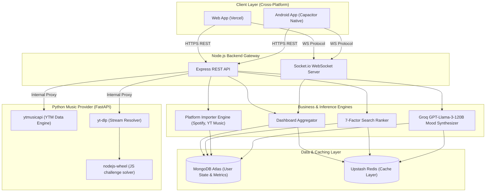

<div align="center">

# SoulSync

**Premium, open-source music streaming — AI playlists, real-time synchronized listening sessions, offline-first, cross-platform client.**

No advertisements. No subscription. No data tracking. Ever.

[](https://soul-sync-beta.vercel.app)
[](https://github.com/itslokeshx/SoulSync/releases/download/v4.0/SoulSync_4.0.apk)
[](https://github.com/itslokeshx/SoulSync/releases/download/v3.0.0/SoulSync_3.0.0.exe)
[-FCC624?style=flat-square&logo=linux&logoColor=black)](https://github.com/itslokeshx/SoulSync/releases/download/v3.0.0/soulsync_3.0.0.deb)
[](https://github.com/itslokeshx/SoulSync/stargazers)
[](LICENSE)

</div>

---

## ⚡ Highlights & Key Features

*   **AI Playlist Synthesis** — Natural language mood-to-track synthesis (GPT-Llama-3-120B via Groq) with multi-key API failover rotation, playlist length verification, and Spotify/YT Music import tools.
*   **Decoupled Streaming Engine** — Hybrid streaming engine powered by **JioSaavn API** and a dedicated **FastAPI Python microservice** for Youtube / YT Music search translation and direct high-quality audio streaming.
*   **SoulLink Real-Time Sync** — Host-controlled synchronization (play, pause, seek, queue) and live chat over WebSocket rooms for synchronized social listening sessions.
*   **Cross-Platform Client** — Client optimized for Web (Vercel) and Android (Capacitor Native) supporting background audio playback, system media control notifications, and offline-first capabilities.
*   **Sleek Custom Sleep Timer** — Native inline Sleep Timer menu replacing browser dialogues. Supports custom minutes entry, back buttons, and presets (like *"End of track"*).
*   **Wrapped Listening Analytics** — In-app listening stats computed in real-time and rendered as premium vinyl graphics and ticket-pass infographics.

---

## 📱 Platform Availability

| Platform | Distribution | Requirements |
|----------|--------------|--------------|
| **Web** | [soul-sync-beta.vercel.app](https://soul-sync-beta.vercel.app) | Modern Web Browser |
| **Android** | [SoulSync_4.0.apk](https://github.com/itslokeshx/SoulSync/releases/download/v4.0/SoulSync_4.0.apk) | Android 7.0+ (API 24+) |
| **Windows** | [SoulSync_3.0.0.exe](https://github.com/itslokeshx/SoulSync/releases/download/v3.0.0/SoulSync_3.0.0.exe) | Windows 10+ |
| **Linux** | [soulsync_3.0.0.deb](https://github.com/itslokeshx/SoulSync/releases/download/v3.0.0/soulsync_3.0.0.deb) | Debian / Ubuntu |

*All current and historical releases are managed on the [Releases](https://github.com/itslokeshx/SoulSync/releases) page.*

---

## ⚙️ System Architecture

SoulSync is structured as a monorepo containing a decoupled frontend client, a Node.js Express/Socket.io gateway, and a Python FastAPI microservice dedicated to YT Music metadata parsing and secure stream resolution.



---

## 🛠️ Local Development Setup

Follow these steps to spin up the local development loop:

### 1. Clone the repository
```bash
git clone https://github.com/itslokeshx/SoulSync.git
cd SoulSync
```

### 2. Install all workspace dependencies
```bash
npm run install:all
```

### 3. Configure environment files
```bash
cp frontend/.env.example frontend/.env
cp backend/.env.example  backend/.env
cp backend/services/music-provider/.env.example backend/services/music-provider/.env
```

### 4. Start development servers
Runs the Frontend client, Node.js gateway, and FastAPI music provider concurrently in one command:
```bash
npm run dev
```

---

## 🔧 Environment Configurations

Ensure the following variables are correctly configured in your local environment files:

#### **`frontend/.env`**
```env
VITE_BACKEND_URL=http://localhost:4000
VITE_GOOGLE_CLIENT_ID=your-google-oauth-client-id
VITE_JIOSAAVN_API=https://saavn.sumit.co/api
```

#### **`backend/.env`**
```env
PORT=4000
MONGODB_URI=mongodb://localhost:27017/soulsync
UPSTASH_REDIS_REST_URL=your-upstash-redis-url
UPSTASH_REDIS_REST_TOKEN=your-upstash-redis-token
GROQ_KEY_1=your-groq-api-key
MUSIC_PROVIDER_URL=http://localhost:4002
```

#### **`backend/services/music-provider/.env`**
```env
UPSTASH_REDIS_REST_URL=your-upstash-redis-url
UPSTASH_REDIS_REST_TOKEN=your-upstash-redis-token
RENDER_EXTERNAL_URL=http://localhost:4002
YT_COOKIES=paste-exported-youtube-cookies-here
```

---

## 🚀 Deployment & Production Tips

### 1. Frontend (Vercel)
Import the repository on Vercel, set frontend environment variables, and deploy. Add your Vercel deployment domain to Google OAuth Credentials Authorized JavaScript Origins.

### 2. Backend Gateway (Render - Node.js)
* **Root Directory**: `backend`
* **Build Command**: `npm install --include=dev && npm run build`
* **Start Command**: `npm start`

### 3. Music Provider (Render - Python FastAPI)
* **Root Directory**: `backend/services/music-provider`
* **Build Command**: `pip install -r requirements.txt`
* **Start Command**: `uvicorn main:app --host 0.0.0.0 --port $PORT`
* **Environment Variables**: Set `PYTHON_VERSION` to `3.11.9`.
* **Render Secret Files**: Upload your exported Netscape-format YouTube cookies as a Secret File under **Environment** named `cookies.txt` (mounted at `/etc/secrets/cookies.txt`). The app will copy it to a writable `/tmp/cookies.txt` directory automatically on boot to bypass read-only restrictions.
* **Keep-Alive**: A background keep-alive loop is built-in to ping `/health` every 14 minutes, preventing Render instances from sleeping.

### 4. Build Android APK
```bash
cd frontend && npm run build
npx cap sync android
cd android && ./gradlew assembleRelease
# The compiled APK is located at: android/app/build/outputs/apk/release/app-release.apk
```

---

## 📄 Community & License

*   **Contributing**: Contributions are welcome. See [CONTRIBUTING.md](CONTRIBUTING.md) for details on code style, formatting, and PR requirements.
*   **License**: SoulSync is open-source software licensed under the [MIT License](LICENSE).
