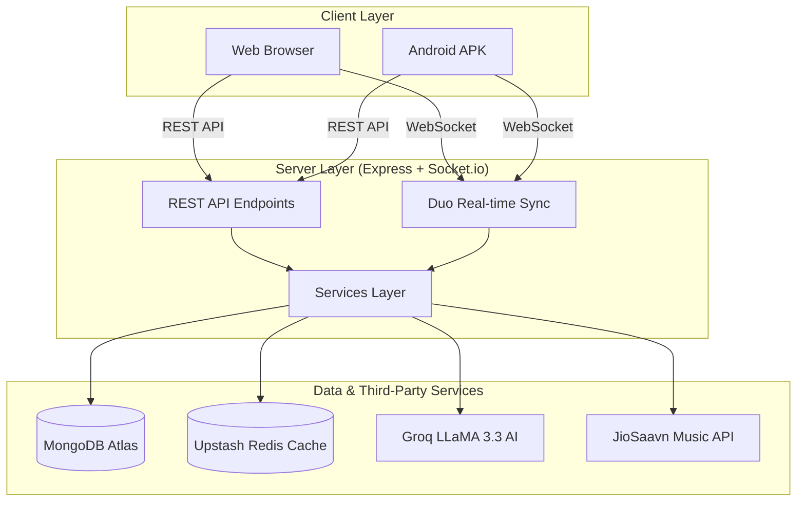

<div align="center">


# ✦ SoulSync

### Listen together. Feel together.

**Free, open-source music streaming — AI playlists, real-time listening sessions, native apps.**
No ads. No subscription. Ever.

[](https://soul-sync-beta.vercel.app/)
[](https://github.com/itslokeshx/SoulSync/releases)
[](LICENSE)
[](https://github.com/itslokeshx/SoulSync/stargazers)

<br>

### ✦ Currently Used By!


_Not a tutorial project — a product people have actually been using!_

</div>

---

## 📥 Downloads

|  Platform  |                                                  Link                                                  |   Requirement   |
| :--------: | :----------------------------------------------------------------------------------------------------: | :-------------: |
|   🌐 Web   |                    [soul-sync-beta.vercel.app](https://soul-sync-beta.vercel.app/)                     |   No install    |
| 📱 Android | [SoulSync_4.0.apk](https://github.com/itslokeshx/SoulSync/releases/download/v4.0/SoulSync_4.0.apk) |  Android 7.0+   |

---

## Why SoulSync?

| Feature                |    SoulSync    | Spotify Free | Spotify Premium |
| :--------------------- | :------------: | :----------: | :-------------: |
| Ad-free                |       ✅       |      ❌      |       ✅        |
| AI Playlists           |       ✅       |      ❌      |       ❌        |
| Listen Together + Chat |       ✅       |      ❌      |       ❌        |
| Offline Downloads      |       ✅       |      ❌      |       ✅        |
| Open Source            |     ✅ MIT     |      ❌      |       ❌        |
| **Price**              | **₹0 forever** |  ₹0 w/ ads   |   ₹119/month    |

---

## ✨ Core Features

### 🔍 Intelligent Search — 7 Ranking Signals

- **Originals first** — covers, karaokes, and tributes are automatically penalized
- **7-factor ranking** — play count (dominant), title/artist match, language preference
- **50 results** per query including artist and album sections
- **Redis cache** — 10-min TTL, repeat searches return in under 50ms

### 🤖 AI Playlist Generator

- **Mood-based** — describe a vibe, get 15 curated songs with a creative name
- **Song matching** — paste a list, AI finds JioSaavn matches automatically
- **Multi-key rotation** — up to 5 Groq API keys with auto-fallback
- **Universal import** — Spotify, YouTube Music, Apple Music, Gaana, or plain text

### 🎧 SoulLink — Listen Together

- **Real-time sync** — host controls (play, pause, seek, queue) sync to all guests
- **6-character room codes** — no account needed to join
- **Built-in chat** — message within the session
- **Heartbeat protocol** — auto-cleanup on disconnect

### 📱 Native Android App

- **Offline without login** — opens directly when offline
- **Lock screen controls** — play / pause / skip from notification
- **Background audio** — keeps playing when minimized
- **Haptic feedback** + swipe player (mini bar ↔ full screen)
- **Dynamic release resolution** — download paths resolve the latest APK release asset directly from GitHub's live API

### 📊 SoulSync Wrapped — Live Listening Story

- **Responsive Viewport Deck**: A gorgeous full-screen visual modal covering the entire viewport, responsive across mobile, tablet, and desktop screens.
- **Dynamic Stats Aggregation**: Real-time calculations of joined date milestones, total minutes listened, total play count, and liked songs directly from Mongo db.
- **Top Songs & Vinyl Disc**: Shows the top 5 most-played songs and rotates a custom album-art styled vinyl record for the primary artist.
- **Ticket Infographic Pass**: Renders an authentic concert ticket pass, featuring perforated edges, barcodes, cutouts, and shareable summaries.

### 🔗 Shareable Links

- Song links: `soul-sync-beta.vercel.app/s/:slug`
- Playlist links: `soul-sync-beta.vercel.app/p/:slug`
- **Rich previews** — album art in WhatsApp, iMessage, Telegram via OG meta tags

### 📢 Announcements & User Feedback

- **Dynamic Updates Engine** — supports versioned and ad-hoc updates (What's New, features, maintenance) with delayed auto-popup modals.
- **Persistent Global Badging** — unread indicators appear on the Profile tab and settings panel, persisting until the active announcement expires.
- **Responsive Media Layouts** — popups automatically adapt to any image aspect ratios (e.g. square album covers) using custom centered flex grids.
- **In-App Feedback submission** — quick feedback drawer for users to submit bug reports and feature recommendations.
- **Triage Dashboard** — admin interface for viewing, status filtering, and deleting feedback, alongside announcement creation utilities.

### ♾️ Auto Song Suggestion (Infinite Playback)

- **Continuous queue filling** — when the queue runs low, SoulSync automatically fetches more songs.
- **Smart recommendation failover** — queries taste recommendation engines or JioSaavn-related tracks to ensure the next song is never `none`.

### ✈️ Offline Mode

| Scenario                |          Web           |          APK           |
| :---------------------- | :--------------------: | :--------------------: |
| Offline + logged in     | ✅ Downloads available | ✅ Downloads available |
| Offline + not logged in |   ❌ Login required    |   ✅ Opens directly    |

---

## ⚡ Performance

| Metric                   | Before | After  | Improvement |
| :----------------------- | :----: | :----: | :---------: |
| Search latency (cached)  |  1.2s  |  45ms  |  **−96%**   |
| Dashboard load (cached)  |  2.1s  |  95ms  |  **−95%**   |
| Results per query        |   20   |   50   |  **+150%**  |
| Original song at rank #1 | Never  | Always |     ✅      |
| Cache hit rate           |   0%   |  78%   |      —      |

---

## 🏗️ Architecture

### System Overview



### Data Flow

```
User Action → Zustand Store → API Call → Express Route → Service Layer → External API
                                              │
                                              ├── MongoDB (persist)
                                              ├── Redis (cache)
                                              └── Socket.io (real-time sync)
```

---

## 📁 Project Structure

```
SoulSync/
├── backend/                       # Express server codebase
│   ├── src/
│   │   ├── middleware/            # Rate limiter, Soft auth & Auth guards
│   │   ├── models/                # MongoDB Schema models (User, Playlist, history)
│   │   ├── routes/                # REST endpoints (AI, Auth, search, etc.)
│   │   ├── services/              # groq AI, Saavn parser, search ranker
│   │   └── socket/                # Socket.io session rooms
│   └── tsconfig.json
│
├── frontend/                      # React Web App & Capacitor android bridge
│   ├── src/
│   │   ├── api/                   # Axios client endpoints
│   │   ├── capacitor/             # Native mobile bindings (Haptics, Notifications)
│   │   ├── components/            # UI pieces (cards, player view, modals)
│   │   ├── duo/                   # SoulLink hooks and store
│   │   ├── hooks/                 # Reusable React hooks
│   │   ├── pages/                 # Routing views (HomePage, AdminPanel, Wrapped)
│   │   ├── store/                 # Zustand global stores (player, queue, UI)
│   │   └── utils/                 # Audio helper, offlineDB configuration
│   └── capacitor.config.ts
│
├── package.json                   # Root monorepo workspace scripts
└── render.yaml                    # Cloud host orchestration configurations
```

---

## 🛠️ Tech Stack

| Layer        | Technologies                                                                             |
| :----------- | :--------------------------------------------------------------------------------------- |
| **Frontend** | React 18.3 · TypeScript 5.7 · Vite 6.1 · Tailwind CSS 3.4 · Zustand 5 · TanStack Query 5 |
| **Mobile**   | Capacitor 8.1 · Android API 24+                                                          |
| **Backend**  | Node.js 18+ · Express 4.21 · Socket.io 4.8 · TypeScript 5.7                              |
| **Data**     | MongoDB 8.9 · Upstash Redis (90-day TTL)                                                 |
| **AI**       | Groq SDK · LLaMA 3.3 70B                                                                 |
| **Auth**     | Google OAuth 2.0 · JWT RS256 · httpOnly cookies                                          |
| **Infra**    | Vercel · Render · MongoDB Atlas                                                          |

---

## 🔒 Security

| Layer          | Implementation                           |
| :------------- | :--------------------------------------- |
| Authentication | Google OAuth 2.0 — no passwords stored   |
| Sessions       | httpOnly · Secure · SameSite cookies     |
| Headers        | Helmet: CORP, COOP, CSP on all responses |
| CORS           | Exact origin validation                  |
| Rate limiting  | 100 req/min global · 15 req/min AI       |
| JWT            | RS256, verified on every protected route |
| Validation     | Zod schemas on all REST endpoints        |

---

## 🚀 Quick Start

### Prerequisites

| Requirement    |       Version       | Notes            |
| :------------- | :-----------------: | :--------------- |
| Node.js        |        ≥ 18         | Required         |
| npm            |         ≥ 9         | Required         |
| MongoDB Atlas  |       Free M0       | Required         |
| Google Cloud   | OAuth 2.0 Client ID | Required         |
| Groq API       |      Free key       | AI features only |
| Android Studio |       Latest        | APK builds only  |

### Setup

```bash
# Clone the repo
git clone https://github.com/itslokeshx/SoulSync.git
cd SoulSync

# Install all dependencies
npm run install:all

# Configure environment
cp frontend/.env.example frontend/.env
cp backend/.env.example backend/.env

# Start dev servers (two terminals)
npm run dev:backend
npm run dev:frontend

# Open http://localhost:5173
```

### Environment Variables

**`frontend/.env`**

```env
VITE_BACKEND_URL=https://your-soulsync-backend.onrender.com
VITE_GOOGLE_CLIENT_ID=your-client-id.apps.googleusercontent.com
VITE_JIOSAAVN_API=https://saavn.sumit.co/api
VITE_DUO_BACKEND=https://your-soulsync-backend.onrender.com
VITE_FRONTEND_URL=https://soul-sync-beta.vercel.app
```

**`backend/.env`**

```env
PORT=4000
NODE_ENV=production
FRONTEND_URL=https://soul-sync-beta.vercel.app

MONGODB_URI=mongodb+srv://<user>:<pass>@<cluster>.mongodb.net/soulsync
JWT_SECRET=your-64-char-hex-secret
GOOGLE_CLIENT_ID=your-client-id.apps.googleusercontent.com

GROQ_KEY_1=gsk_xxxxx
GROQ_KEY_2=gsk_xxxxx
JIOSAAVN_API=https://saavn.sumit.co/api

UPSTASH_REDIS_REST_URL=https://your-db.upstash.io
UPSTASH_REDIS_REST_TOKEN=AXxxxxxxxxxx
```

> ⚠️ `JIOSAAVN_API` must be in `backend/.env` **without** the `VITE_` prefix.

---

## 🌍 Deployment

### Frontend → Vercel

1. Push to GitHub and import on [vercel.com](https://vercel.com)
2. Set all `VITE_*` environment variables
3. Deploy — `vercel.json` is already included
4. Add your deployed URL to Google OAuth authorized origins

### Backend → Render

1. Create a Web Service and connect your GitHub repo
2. Root directory: `backend`
3. Build command: `npm install --include=dev && npm run build`
4. Start command: `npm start`
5. Set all env vars — especially `JIOSAAVN_API` (no `VITE_` prefix)

### Android APK

```bash
cd frontend && npm run build
npx cap sync android
cd android && ./gradlew assembleRelease
# → android/app/build/outputs/apk/release/app-release.apk
```

---

## 📡 API Reference

| Method | Endpoint                              | Description                       |
| :----: | :------------------------------------ | :-------------------------------- |
| `POST` | `/api/auth/google`                    | Authenticate with Google ID token |
| `GET`  | `/api/search?q=...&lang=...&limit=50` | 7-factor ranked search            |
| `GET`  | `/api/search/artist/:id`              | Top songs by artist               |
| `GET`  | `/api/search/album/:id`               | Full album tracklist              |
| `POST` | `/api/share/song`                     | Generate shareable song slug      |
| `POST` | `/api/share/playlist`                 | Generate shareable playlist slug  |
| `GET`  | `/api/share/s/:slug`                  | Get shared song (no auth)         |
| `GET`  | `/api/share/p/:slug`                  | Get shared playlist (no auth)     |
| `POST` | `/api/import/detect`                  | Detect platform from URL          |
| `GET`  | `/api/dashboard`                      | Personalized dashboard (auth)     |
| `GET`  | `/api/dashboard/guest`                | Guest dashboard                   |
| `POST` | `/api/ai/generate`                    | Generate playlist from mood       |
| `POST` | `/api/ai/match`                       | Match songs from list             |
| `POST` | `/api/session/create`                 | Create SoulLink room              |
| `POST` | `/api/session/join`                   | Join SoulLink room                |
| `GET`  | `/api/user/stats`                     | Get user Wrapped stats & timeline |
| `POST` | `/api/feedback`                       | Submit user feedback              |
| `GET`  | `/api/feedback/admin`                 | [Admin] Retrieve feedback list    |
| `PATCH`| `/api/feedback/admin/:id`             | [Admin] Update feedback status    |
| `DELETE`|`/api/feedback/admin/:id`             | [Admin] Delete feedback entry     |
| `GET`  | `/api/announcements/active`           | Get active announcements (public) |
| `GET`  | `/api/announcements/admin`            | [Admin] List all announcements    |
| `POST` | `/api/announcements/admin`            | [Admin] Create announcement       |
| `PATCH`| `/api/announcements/admin/:id`        | [Admin] Update announcement       |
| `DELETE`|`/api/announcements/admin/:id`        | [Admin] Delete announcement       |
---

## 🐛 Troubleshooting

<details>
<summary><b>Songs won't play / silent playback</b></summary>

Always call `normalizeSong()` before `loadAndPlay()`:

```typescript
const normalized = normalizeSong(song);
loadAndPlay(normalized);
```

On APK, use `Capacitor.convertFileSrc()` for downloaded files:

```typescript
if (Capacitor.isNativePlatform()) {
  audioUrl = Capacitor.convertFileSrc(localPath);
}
```

</details>

<details>
<summary><b>SoulLink desync</b></summary>

`isHost` must be a `ref`, not state, to prevent stale closures in socket listeners:

```typescript
const isHostRef = useRef(isHost);
isHostRef.current = isHost;
```

Also verify `socket.connected === true` and both users share the same 6-character code.

</details>

<details>
<summary><b>Search returns covers before originals</b></summary>

Verify `JIOSAAVN_API` (no `VITE_` prefix) is set in `backend/.env`. Clear Redis cache or wait for the 10-minute TTL.

</details>

<details>
<summary><b>APK won't install</b></summary>

Enable unknown sources: **Settings → Security → Install unknown apps → Allow**. Requires Android 7.0 (API 24)+.

</details>

<details>
<summary><b>Backend 502 / connection refused</b></summary>

First request after inactivity on Render's free tier takes 30–60s. The built-in self-ping at 13-min intervals mitigates cold starts.

</details>

<details>
<summary><b>Environment variables not loading</b></summary>
```bash
# ❌ Wrong — backend cannot read VITE_ prefix
VITE_JIOSAAVN_API=https://saavn.sumit.co/api

# ✅ Correct in backend/.env

JIOSAAVN_API=https://saavn.sumit.co/api

````

Always restart both dev servers after editing `.env` files.
</details>

---

## 🤝 Contributing
```bash
# 1. Fork and clone
git clone https://github.com/YOUR_USERNAME/SoulSync.git

# 2. Create a branch
git checkout -b feat/your-feature

# 3. Install and configure
npm run install:all
cp frontend/.env.example frontend/.env
cp backend/.env.example backend/.env

# 4. Develop and verify
npm run typecheck
npm run dev:backend   # terminal 1
npm run dev:frontend  # terminal 2

# 5. Commit and push
git commit -m "feat: your feature description"
git push origin feat/your-feature

# 6. Open a pull request
````

**Commit convention:** `feat` · `fix` · `docs` · `style` · `refactor` · `perf` · `chore`

**PR checklist:**

- [ ] `npm run build` passes
- [ ] `npm run typecheck` passes
- [ ] No console errors
- [ ] Tested on Chrome, Firefox, Safari (web)
- [ ] Tested on Android (if APK changes)

[→ Browse good first issues](https://github.com/itslokeshx/SoulSync/labels/good%20first%20issue)

---

## 🙏 Acknowledgments

| Project                                                               | Role                     |
| :-------------------------------------------------------------------- | :----------------------- |
| [sumitkolhe/jiosaavn-api](https://github.com/sumitkolhe/jiosaavn-api) | Music streaming backbone |
| [Groq Cloud](https://groq.com)                                        | LLaMA 3.3 70B inference  |
| [Ionic Capacitor](https://github.com/ionic-team/capacitor)            | Native Android bridge    |
| [Socket.io](https://github.com/socketio/socket.io)                    | Real-time duo sessions   |
| [Zustand](https://github.com/pmndrs/zustand)                          | State management         |
| [Framer Motion](https://github.com/framer/motion)                     | Animations               |

---

## 📄 License

Distributed under the [MIT License](LICENSE).

---

<div align="center">

**Built with ❤️ by [Loki](https://github.com/itslokeshx)**

_No ads. No paywalls. No limits. Simply pure music._

[](https://github.com/itslokeshx)
[](https://twitter.com/itslokeshx)
[](https://linkedin.com/in/itslokeshx)

_If SoulSync saved you ₹119/month — drop a ⭐_


</div>
