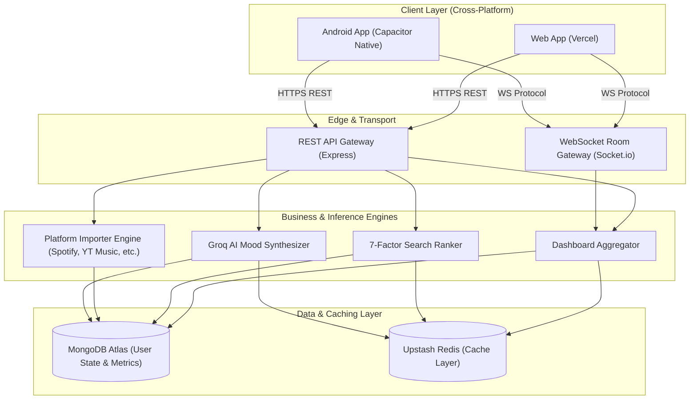

<div align="center">

# SoulSync

**Open-source music streaming — AI playlists, real-time listening sessions, offline-first, cross-platform.**

No advertisements. No subscription. No data resale. Ever.

[](https://soul-sync-beta.vercel.app)
[](https://github.com/itslokeshx/SoulSync/releases/download/v4.0/SoulSync_4.0.apk)
[](https://github.com/itslokeshx/SoulSync/releases/download/v3.0.0/SoulSync_3.0.0.exe)
[-FCC624?style=flat-square&logo=linux&logoColor=black)](https://github.com/itslokeshx/SoulSync/releases/download/v3.0.0/soulsync_3.0.0.deb)
[](https://github.com/itslokeshx/SoulSync/stargazers)
[](LICENSE)

</div>

---

## Highlights

- **AI Playlist Synthesis** — Natural language mood-to-track synthesis (LLaMA 3.3 via Groq) with multi-key failover rotation and Spotify/YT Music import tools.
- **SoulLink Real-Time Sync** — Host-controlled synchronization (play, pause, seek, queue) and live chat over WebSocket rooms.
- **Cross-Platform Native** — Client optimized for Web (Vercel) and Android (Capacitor) supporting background audio, system media controls, and offline-first playback.
- **Wrapped Listening Analytics** — In-app listening stats computed in real-time and rendered as vinyl graphics and ticket-pass infographics.

---

## Platform Availability

| Platform | Distribution | Requirements |
|----------|--------------|--------------|
| **Web** | [soul-sync-beta.vercel.app](https://soul-sync-beta.vercel.app) | Modern Web Browser |
| **Android** | [SoulSync_4.0.apk](https://github.com/itslokeshx/SoulSync/releases/download/v4.0/SoulSync_4.0.apk) | Android 7.0+ (API 24+) |
| **Windows** | [SoulSync_3.0.0.exe](https://github.com/itslokeshx/SoulSync/releases/download/v3.0.0/SoulSync_3.0.0.exe) | Windows 10+ |
| **Linux** | [soulsync_3.0.0.deb](https://github.com/itslokeshx/SoulSync/releases/download/v3.0.0/soulsync_3.0.0.deb) | Debian / Ubuntu |

*All current and historical releases are managed on the [Releases](https://github.com/itslokeshx/SoulSync/releases) page.*

---

## System Architecture

SoulSync is structured as a monorepo containing a decoupled frontend client and a stateless backend API gateway.



---

## Getting Started

### Local Setup

Run the following commands in your terminal to spin up the local development loop:

```bash
# 1. Clone the repository
git clone https://github.com/itslokeshx/SoulSync.git
cd SoulSync

# 2. Install all workspace dependencies
npm run install:all

# 3. Configure environment files
cp frontend/.env.example frontend/.env
cp backend/.env.example  backend/.env

# 4. Start development servers (runs frontend, Node backend, and Python music provider concurrently in one terminal)
npm run dev
```

### Minimal Configuration

Ensure the following vital keys are populated in your local configuration:

**`frontend/.env`**
```env
VITE_BACKEND_URL=http://localhost:4000
VITE_GOOGLE_CLIENT_ID=your-google-oauth-client-id
VITE_JIOSAAVN_API=https://saavn.sumit.co/api
```

**`backend/.env`**
```env
PORT=4000
MONGODB_URI=mongodb://localhost:27017/soulsync
UPSTASH_REDIS_REST_URL=your-redis-url
UPSTASH_REDIS_REST_TOKEN=your-redis-token
GROQ_KEY_1=your-groq-api-key
```

---

## Deployment Quick Ref

### Frontend (Vercel)
Import the repository on Vercel, set frontend environment variables, and deploy. Ensure the deployed URL is added to the Google OAuth Authorized JavaScript Origins.

### Backend (Render)
Create a new Web Service connected to the repository. Set the Root Directory to `backend`, Build Command to `npm install --include=dev && npm run build`, and Start Command to `npm start`.

### Android APK Build
```bash
cd frontend && npm run build
npx cap sync android
cd android && ./gradlew assembleRelease
# Output located at: android/app/build/outputs/apk/release/app-release.apk
```

---

## Community & License

- **Contributing**: Contributions are welcome. See [CONTRIBUTING.md](CONTRIBUTING.md) for details on code style, formatting, and PR requirements.
- **License**: SoulSync is open-source software licensed under the [MIT License](LICENSE).
