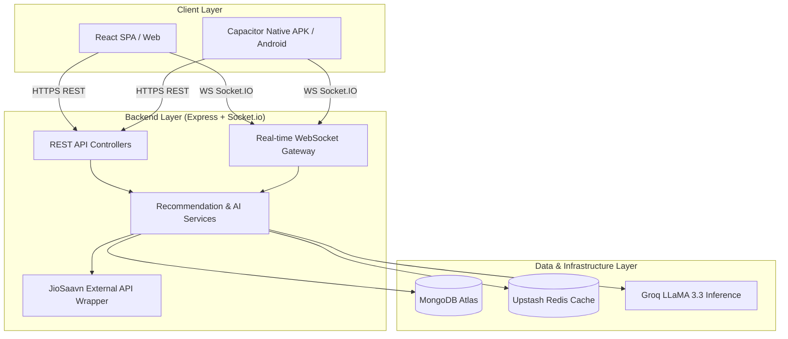

# SoulSync

**A production-ready, ad-free music streaming platform featuring real-time group listening, offline playback, and AI-driven personalized recommendations.**

[](https://soul-sync-beta.vercel.app/)
[](https://github.com/itslokeshx/SoulSync/releases)
[](LICENSE)

SoulSync is a full-scale music streaming application currently used by **180+ active users**, with over **6,000+ tracks streamed** and **150+ custom playlists** generated. It consists of a containerized Express backend, a React SPA, and a Capacitor-based native Android client.

---

## 📥 Download

| Platform | Download Link | Requirements |
| :--- | :--- | :--- |
| **📱 Android App** | [SoulSync_4.0.apk (Direct Download)](https://github.com/itslokeshx/SoulSync/releases/download/v4.0/SoulSync_4.0.apk) | Android 7.0+ (API 24+) |

---

## Architecture Overview

SoulSync enforces strict separation of concerns, decoupling transport layers, business engines, and database access patterns.

### System Topology



### Codebase Organization

```
SoulSync/
├── backend/                       # Express + TS backend
│   ├── src/
│   │   ├── middleware/            # Rate limiting, auth gates, CORS configurations
│   │   ├── models/                # MongoDB schema definitions (Mongoose)
│   │   ├── routes/                # Route definitions & REST controllers
│   │   ├── services/              # Recommendation engines, Groq, caching, JioSaavn
│   │   └── socket/                # Socket.io connection rooms & heartbeat gateway
│   └── tsconfig.json
│
├── frontend/                      # React SPA + Capacitor project
│   ├── src/
│   │   ├── api/                   # Axios HTTP client requests
│   │   ├── capacitor/              # Native platform bindings (Haptics, Media Controls)
│   │   ├── components/            # UI components (player, queue, custom wrappers)
│   │   ├── duo/                   # Real-time listening room hooks
│   │   ├── hooks/                 # Custom React hooks (useDashboard, useMixes)
│   │   ├── pages/                 # Full-screen viewports (Home, Library, Wrapped)
│   │   └── store/                 # Zustand state slices (player, queue, UI state)
│   └── capacitor.config.ts
```

---

## Technical Decisions & Performance Engineering

### 1. Eliminating HTTP waterfalls in dashboard aggregation (6.2s → 300ms)
- **Problem**: The initial homepage dashboard load was bottlenecked (taking 5–10s) due to deep sequential requests. The recommendation engine performed sequential HTTP queries to JioSaavn's API for co-occurring tracks (up to 30 sequential loops), alongside serialized MongoDB queries.
- **Solution**:
  - Consolidated separate database lookups for user stats, liked tracks, and language preferences into a single `User.findById(userId).select("name preferences likedSongs").lean()` call.
  - Wrapped independent collection fetches (weekly mixes, listening history, playlists) in a concurrent `Promise.all` block.
  - Replaced sequential co-occurrence API calls with a bounded concurrency pool to avoid overwhelming the JioSaavn wrapper, using `Promise.allSettled` so a single failed fetch doesn't fail the whole batch.
- **Result**: Average initial dashboard API response time dropped from **~6 seconds to ~300ms**.

### 2. Autoplay queue: cursor architecture, not a mutating array
- **Decision**: Rather than removing tracks from the queue as they're played, SoulSync uses a non-destructive queue with an index pointer (cursor).
- **Trade-off**: Slightly more client-side state to track, but it lets users step backward and forward through history naturally, preserves state for offline restoration, and keeps a continuous playback history without synchronization issues between the queue and the player.

### 3. Asynchronous taste-profile recomputation (fire-and-forget)
- **Decision**: The dashboard periodically checks whether a user's recommendation taste profile is stale (recalculated every N plays). Instead of blocking the dashboard response while recalculating, the check and rebuild run asynchronously as a background task.
- **Trade-off**: The client gets served the cached profile immediately, and the taste profile updates out-of-band — no blocking computation sits in the request/response path.

### 4. Isolated cache layer
- **Decision**: Redis reads and writes are isolated behind dedicated wrappers rather than called directly from business logic.
- **Trade-off**: Redis connectivity issues or missing local setup don't crash the app — it falls back to MongoDB reads and an in-memory cache in dev, keeping application stability decoupled from caching infrastructure health.

---

## Core Features

- **Search ranking**: A multi-factor ranking formula that prioritizes original recordings over covers/tributes, with cached weights for high-frequency queries.
- **Groq-powered mood playlists**: Uses LLaMA-3.3-70B on Groq to parse natural-language moods and generate playlists, with automatic fallback across multiple API keys.
- **Real-time group listening**: Synchronized playback rooms via Socket.IO — play/pause, queue position, and seek all stay in sync across participants, with a heartbeat protocol to clear idle connections.
- **Progressive UI rendering**: The homepage streams in static content and weekly mixes immediately, filling in personalized recommendations as the remaining API calls resolve.
- **Offline playback**: Caches audio to the native filesystem on Android via Capacitor, enabling offline startup without requiring authentication.

---

## Technology Stack

| Layer | Technology | Key Libraries / Frameworks |
| :--- | :--- | :--- |
| **Frontend** | React 18.3, TypeScript 5.7 | Vite 6.1 · Zustand 5 · TanStack Query 5 · Tailwind CSS 3.4 |
| **Mobile Bridge** | Ionic Capacitor 8.1 | `@capacitor/filesystem` · `@capacitor/preferences` |
| **Backend** | Node.js, Express 4.21 | Socket.IO 4.8 · Winston 3.17 · Zod 3.25 · JWT |
| **Data Layer** | MongoDB, Redis | Mongoose 8.9 · Upstash Redis |
| **AI Inference** | Groq Cloud | `groq-sdk` (LLaMA 3.3 70B) |

---

## Setup & Local Execution

### Prerequisites
- Node.js ≥ 18
- MongoDB instance (local or Atlas)
- Redis instance (Upstash or local)

### Installation

1. **Clone the repository**
   ```bash
   git clone https://github.com/itslokeshx/SoulSync.git
   cd SoulSync
   ```

2. **Install all workspace dependencies**
   ```bash
   npm run install:all
   ```

3. **Configure environment variables**

   Create `backend/.env`:
   ```env
   PORT=4000
   NODE_ENV=development
   FRONTEND_URL=http://localhost:5173
   MONGODB_URI=your_mongodb_connection_string
   JWT_SECRET=your_jwt_secret
   JIOSAAVN_API=https://saavn.sumit.co/api
   UPSTASH_REDIS_REST_URL=your_redis_url
   UPSTASH_REDIS_REST_TOKEN=your_redis_token
   ```

   Create `frontend/.env`:
   ```env
   VITE_BACKEND_URL=http://localhost:4000
   VITE_JIOSAAVN_API=https://saavn.sumit.co/api
   VITE_DUO_BACKEND=http://localhost:4000
   ```

4. **Start the development servers**

   Terminal 1 (backend):
   ```bash
   npm run dev:backend
   ```

   Terminal 2 (frontend):
   ```bash
   npm run dev:frontend
   ```

5. **Build the native Android APK**
   ```bash
   cd frontend
   npm run apk
   # Output: frontend/android/app/build/outputs/apk/debug/app-debug.apk
   ```

---

## License

MIT