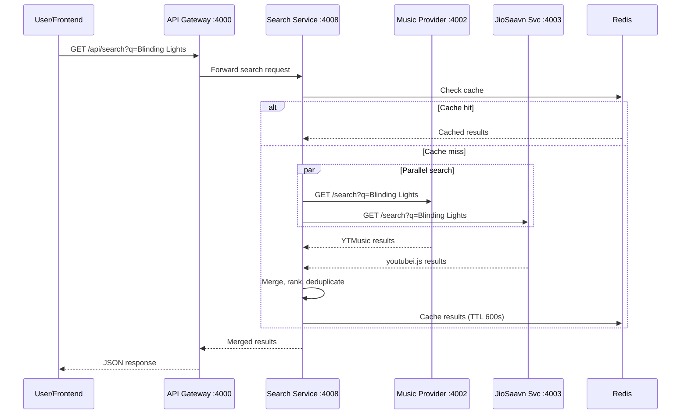
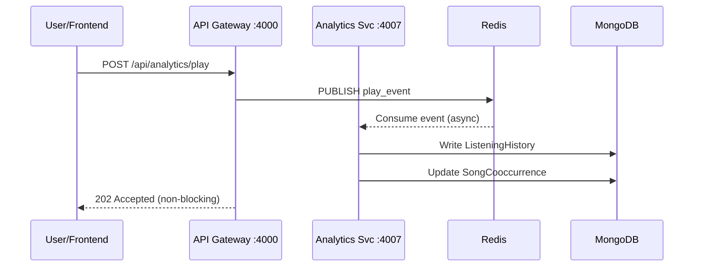
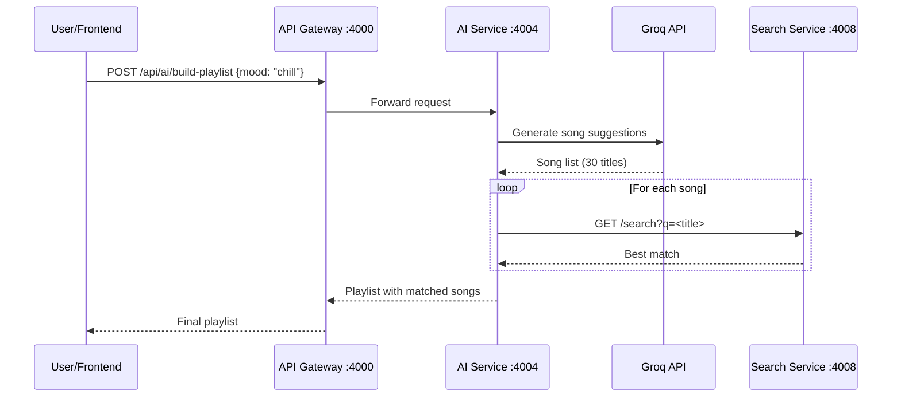
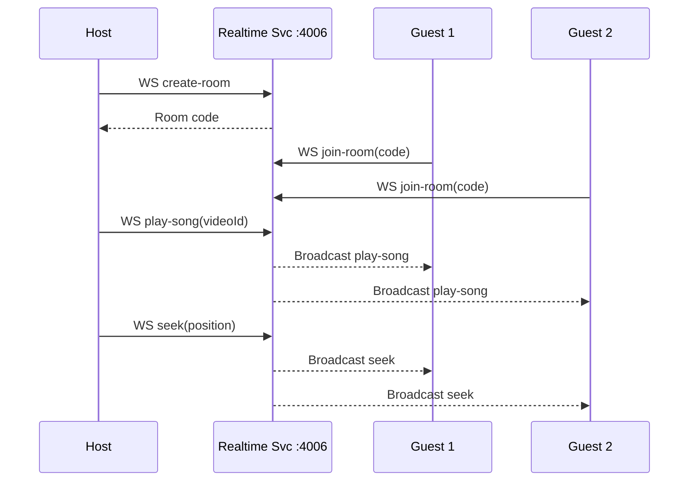

# SoulSync Microservices Architecture Plan

**Date:** 2026-07-18 | **Version:** 1.0

---

## 1. Service Definitions

### 1.1 — API Gateway (`api-gateway`)
- **Runtime:** Node.js (existing monolith, port 4000)
- **Responsibilities:** Reverse proxy, auth middleware, rate limiting, CORS, health aggregation
- **Endpoints:** All `/api/*` routes, `WS /socket.io`
- **Data:** None (stateless)
- **External deps:** None
- **Communication:** HTTP proxy to downstream services

### 1.2 — Auth Service (`auth-service`)
- **Runtime:** Node.js, port 4001
- **Responsibilities:** Google OAuth flow, JWT issue/verify, user CRUD, preferences
- **Endpoints:** `POST /auth/google`, `POST /auth/login`, `POST /auth/register`, `GET /auth/me`, `POST /auth/logout`, `GET /health`
- **Data:** MongoDB `users` collection
- **External deps:** Google Auth Library
- **Communication:** HTTP REST (called by gateway)

### 1.3 — Music Provider Service (`music-provider-svc`)
- **Runtime:** Python/FastAPI, port 4002
- **Responsibilities:** All `ytmusicapi` calls — home feed, search, songs, artists, albums, playlists, podcasts, charts, moods
- **Endpoints:** See §4.4 Router Implementations
- **Data:** None (stateless, read-only from YTM)
- **External deps:** `ytmusicapi`
- **Communication:** HTTP REST (called by gateway or search-svc)

### 1.4 — JioSaavn Service (`jiosaavn-svc`)
- **Runtime:** Node.js, port 4003 (extracted from existing `youtubeMusicService.ts`)
- **Responsibilities:** Stream URL resolution via `youtubei.js`, legacy JioSaavn proxy
- **Endpoints:** `GET /stream/:id`, `GET /song/:id`, `GET /search`, `GET /health`
- **Data:** None (stateless)
- **External deps:** `youtubei.js`
- **Communication:** HTTP REST

### 1.5 — AI Service (`ai-service`)
- **Runtime:** Node.js, port 4004
- **Responsibilities:** Groq LLaMA integration, AI playlist generation, mood synthesis
- **Endpoints:** `POST /build-playlist`, `GET /health`
- **Data:** Redis (playlist cache)
- **External deps:** Groq SDK
- **Communication:** HTTP REST, calls search-svc to resolve songs

### 1.6 — Recommendation Service (`recommendation-svc`)
- **Runtime:** Node.js, port 4005
- **Responsibilities:** Taste profile, co-occurrence matrix, personalized mixes, autoplay
- **Endpoints:** `GET /home`, `GET /next`, `POST /feed/more`, `GET /health`
- **Data:** MongoDB `userTasteProfiles`, `songCooccurrences`, `userMixSets`
- **External deps:** None
- **Communication:** HTTP REST, Redis pub/sub for play events

### 1.7 — Realtime Service (`realtime-svc`)
- **Runtime:** Node.js, port 4006
- **Responsibilities:** Socket.IO server, SoulLink rooms, live chat
- **Endpoints:** `WS /socket.io`, `GET /health`
- **Data:** MongoDB `duoSessions`
- **External deps:** None
- **Communication:** WebSocket, Redis pub/sub

### 1.8 — Analytics Service (`analytics-svc`)
- **Runtime:** Node.js, port 4007
- **Responsibilities:** Play events, listening history, Wrapped stats, dashboard data
- **Endpoints:** `POST /play`, `GET /history`, `GET /wrapped`, `GET /dashboard`, `GET /health`
- **Data:** MongoDB `listeningHistory`
- **External deps:** None
- **Communication:** Redis pub/sub (consume play events)

### 1.9 — Search Service (`search-svc`)
- **Runtime:** Node.js, port 4008
- **Responsibilities:** Intent parsing, smart search, result merging across providers
- **Endpoints:** `GET /search`, `GET /suggestions`, `GET /health`
- **Data:** Redis (search cache)
- **External deps:** None
- **Communication:** HTTP to `music-provider-svc` + `jiosaavn-svc` in parallel

---

## 2. API Gateway Routing Table

```
GET  /api/search/*           → search-svc:4008
GET  /api/music/home         → music-provider-svc:4002
GET  /api/music/song/:id     → music-provider-svc:4002
GET  /api/music/watch/:id    → music-provider-svc:4002
GET  /api/music/podcast/:id  → music-provider-svc:4002
GET  /api/music/charts       → music-provider-svc:4002
GET  /api/music/moods        → music-provider-svc:4002
GET  /api/music/*            → music-provider-svc:4002
GET  /api/search/stream      → jiosaavn-svc:4003  (stream proxy MUST stay on youtubei.js)
POST /api/ai/build-playlist  → ai-service:4004
GET  /api/recommendations/*  → recommendation-svc:4005
POST /api/analytics/play     → analytics-svc:4007
GET  /api/analytics/wrapped  → analytics-svc:4007
GET  /api/dashboard/*        → analytics-svc:4007
WS   /socket.io              → realtime-svc:4006
POST /api/auth/*             → auth-service:4001
GET  /api/auth/*             → auth-service:4001
GET  /api/playlists/*        → auth-service:4001  (user-owned data)
POST /api/user/*             → auth-service:4001
```

---

## 3. Data Flow Diagrams

### 3.1 — Search Flow



### 3.2 — Play Event Flow



### 3.3 — AI Playlist Flow



### 3.4 — SoulLink Flow



---

## 4. Deployment Strategy

| Service | Platform | Port | Health Check | Keep-Alive |
|---|---|---|---|---|
| api-gateway | Render (Node) | 4000 | `GET /health` | Yes (13 min) |
| auth-service | Render (Node) | 4001 | `GET /health` | Yes |
| music-provider-svc | Render (Python) | 4002 | `GET /health` | Yes |
| jiosaavn-svc | Render (Node) | 4003 | `GET /health` | Yes |
| ai-service | Render (Node) | 4004 | `GET /health` | On-demand |
| recommendation-svc | Render (Node) | 4005 | `GET /health` | Yes |
| realtime-svc | Render (Node) | 4006 | `GET /health` | Yes |
| analytics-svc | Render (Node) | 4007 | `GET /health` | On-demand |
| search-svc | Render (Node) | 4008 | `GET /health` | Yes |

**Environment Variable Segregation:** Each service gets only its required env vars:
- `auth-service`: `MONGODB_URI`, `JWT_SECRET`, `GOOGLE_CLIENT_ID`, `GOOGLE_CLIENT_SECRET`
- `music-provider-svc`: `YTMUSIC_AUTH_TYPE`
- `ai-service`: `GROQ_KEY_1..5`, `SEARCH_SVC_URL`
- `analytics-svc`: `MONGODB_URI`, `UPSTASH_REDIS_REST_URL`

---

## 5. Migration Strategy (Zero Downtime — Strangler Fig)

### Phase A — Extract Music Provider (Week 1-2)
- Deploy `music-provider-svc` (Python/FastAPI) as new Render service
- Add proxy route in monolith: `/api/music/*` → Python service
- Monolith keeps all existing routes working
- **Test:** Home feed, charts, moods work via new Python service

### Phase B — Extract Auth (Week 3-4)
- Deploy `auth-service` with same JWT verification logic
- Monolith delegates to auth-service for `/api/auth/*`
- All other routes still verify JWT locally (dual mode)

### Phase C — Extract Analytics (Week 5-6)
- Deploy `analytics-svc`
- Monolith publishes play events to Redis pub/sub
- Analytics service consumes and writes to MongoDB
- Dashboard endpoints move to analytics-svc

### Phase D — Extract Realtime (Week 7-8)
- Deploy `realtime-svc` with Socket.IO
- Update frontend `VITE_DUO_BACKEND` to point to new service
- Monolith becomes stateless (no WebSocket handling)

### Phase E — Full Decomposition (Week 9-12)
- Extract remaining services (AI, Recommendations, Search)
- Monolith becomes pure API gateway (routing only)
- All services independently deployable and scalable
